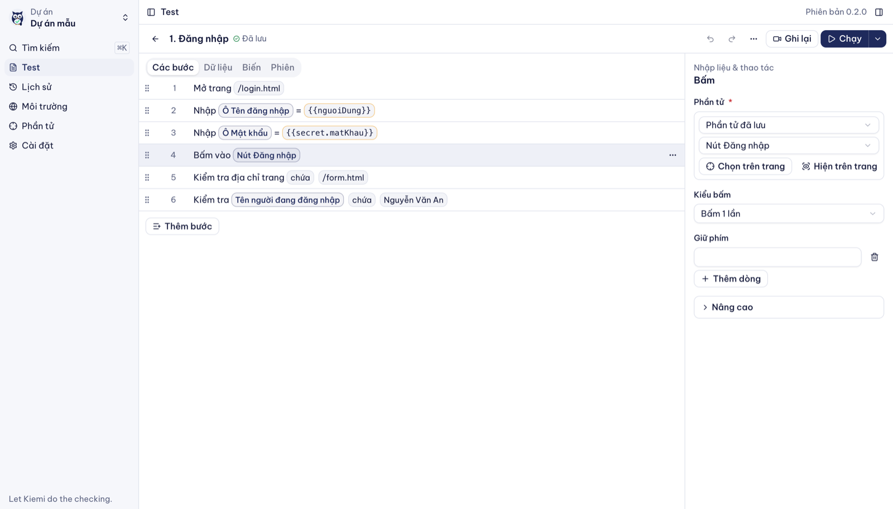
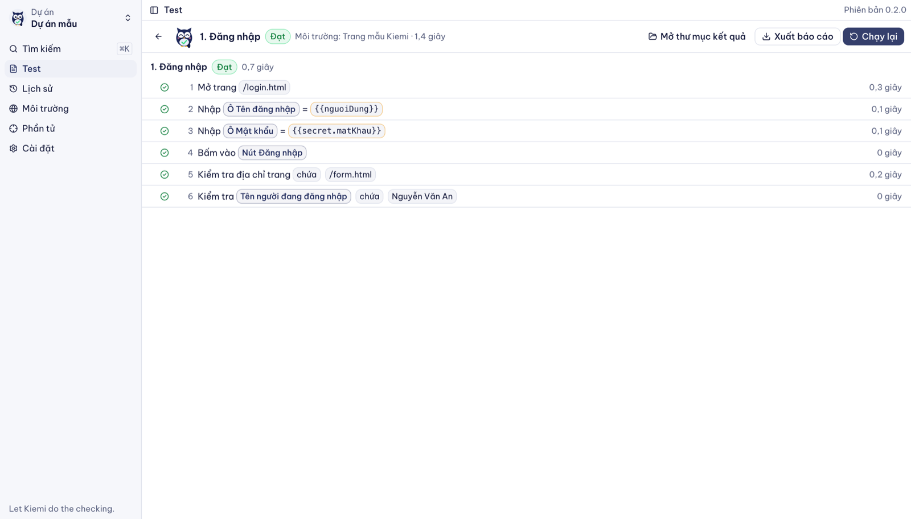
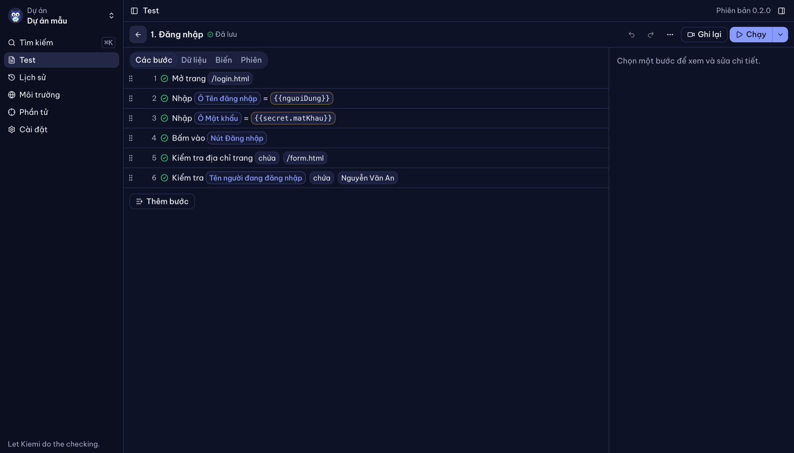

<div align="center">


<h1>
  
  Kiemi
</h1>

### *Let Kiemi do the checking.*

Kiểm thử giao diện web **không cần viết code**.<br>
Bạn thao tác trên trang như bình thường — Kiemi ghi lại, chạy lại, và báo cho bạn chỗ nào hỏng.

[](https://github.com/NguyenKhanhDuy0112/kiemi/releases/latest)
[](https://github.com/NguyenKhanhDuy0112/kiemi/releases)


[](https://github.com/NguyenKhanhDuy0112/kiemi/actions/workflows/ci.yml)

<br>

[](https://github.com/NguyenKhanhDuy0112/kiemi/releases/latest/download/Kiemi-Setup.exe)
&nbsp;
[](https://github.com/NguyenKhanhDuy0112/kiemi/releases/latest/download/Kiemi-mac.dmg)

<sub>[Windows portable — không cần cài](https://github.com/NguyenKhanhDuy0112/kiemi/releases/latest/download/Kiemi-Portable.exe) · [Mọi phiên bản](https://github.com/NguyenKhanhDuy0112/kiemi/releases) · [Hướng dẫn sử dụng](docs/user-guide/README.md)</sub>

</div>

---

## Hoạt động thế nào

| 🎥 1. Ghi lại | ▶️ 2. Chạy | ✅ 3. Xem kết quả |
|---|---|---|
| Bấm **Ghi lại**, thao tác trên trang web như bình thường. Mỗi thao tác thành một bước đọc như câu tiếng Việt: *Bấm vào `Nút Lưu`*. | Bấm **Chạy** — Kiemi tự mở Edge/Chrome và làm lại đúng từng bước, với một hoặc nhiều bộ dữ liệu. | Từng bước **Đạt / Không đạt**, lỗi nói bằng tiếng Việt dễ hiểu, kèm ảnh chụp khoanh đỏ đúng chỗ hỏng. |

<table>
  <tr>
    <td width="50%"></td>
    <td width="50%"></td>
  </tr>
  <tr>
    <td align="center"><sub>Các bước đọc như câu — bấm vào bước để sửa ở panel bên phải</sub></td>
    <td align="center"><sub>Kết quả từng bước — Cú Kiemi vui khi test Đạt</sub></td>
  </tr>
</table>

## Vì sao chọn Kiemi

| | |
|---|---|
| 🙌 **Không cần biết code** | Không selector, không script. Phần tử được gọi bằng tên dễ hiểu: *Ô Mật khẩu*, *Nút Đăng nhập*. |
| 🧠 **Ghi lại thông minh** | Tự gợi ý bước kiểm tra khi trang thay đổi, tự nhận ô mật khẩu để lưu thành bí mật, biến giá trị đã gõ thành bảng dữ liệu. |
| 📊 **Nhiều dữ liệu, nhiều vai trò** | Nhập dữ liệu từ Excel/CSV, sinh dữ liệu giả tiếng Việt; một test có thể có *nhân viên tạo đơn → quản lý duyệt*. |
| 🔎 **Lỗi dễ hiểu** | *"Bước 5: Không tìm thấy nút 'Lưu' sau 10 giây"* + gợi ý cách sửa, ảnh chụp, video, xem lại từng thao tác, báo cáo HTML. |
| 🔒 **Riêng tư & offline** | Chạy hoàn toàn trên máy bạn, không tài khoản. Mật khẩu được mã hóa bằng khóa của hệ điều hành và luôn bị che. |
| 🏢 **Hợp môi trường doanh nghiệp** | Cài không cần quyền admin, có bản portable cho máy chỉ vào được qua Remote Desktop, hỗ trợ proxy và SSH. |
| 🔄 **Luôn mới** | Tự kiểm tra bản mới, tải ngầm, bấm một nút để cập nhật — test và dữ liệu giữ nguyên. |

## Gặp Cú Kiemi 🦉


Cú Kiemi đi cùng bạn trong app: **chăm chú** khi test đang chạy, **nhún nhảy** khi mọi bước Đạt, **lo lắng** khi có bước hỏng. Thích yên tĩnh hơn? Bật **Cài đặt → Giảm chuyển động**.

Có cả giao diện tối:



## Cài đặt

| Máy | File | Cách cài |
|---|---|---|
| **Windows 10/11** | [`Kiemi-Setup.exe`](https://github.com/NguyenKhanhDuy0112/kiemi/releases/latest/download/Kiemi-Setup.exe) | Bấm đúp là xong — cài cho riêng tài khoản của bạn, **không cần quyền quản trị**. |
| **Windows — không cài được** | [`Kiemi-Portable.exe`](https://github.com/NguyenKhanhDuy0112/kiemi/releases/latest/download/Kiemi-Portable.exe) | Chép vào máy (kể cả server qua Remote Desktop) rồi bấm đúp. |
| **macOS** (Intel & Apple Silicon) | [`Kiemi-mac.dmg`](https://github.com/NguyenKhanhDuy0112/kiemi/releases/latest/download/Kiemi-mac.dmg) | Mở file, kéo **Kiemi** vào **Applications**. |

> [!NOTE]
> Bản hiện tại **chưa được ký số**, nên lần đầu mở:
> - **Windows** hiện *"Windows protected your PC"* → **More info** → **Run anyway**.
> - **macOS** báo *không xác định được nhà phát triển* → chuột phải vào **Kiemi** → **Mở** → **Mở**.

Kiemi dùng **Microsoft Edge** hoặc **Google Chrome** có sẵn trên máy. Không có cả hai thì lần chạy đầu Kiemi tự tải một trình duyệt (một lần, khoảng 150 MB). Mở app lần đầu, chọn **Mở test mẫu** để xem Kiemi chạy ngay — không cần mạng.

## Câu hỏi thường gặp

<details>
<summary><b>Dữ liệu của tôi nằm ở đâu? Có gửi đi đâu không?</b></summary>

Mọi thứ nằm trên máy bạn: Windows `%APPDATA%\Kiemi`, macOS `~/Library/Application Support/Kiemi`. Kiemi không gửi test hay dữ liệu đi đâu. Báo lỗi ẩn danh là tùy chọn, **mặc định tắt**, và không bao giờ chứa test, dữ liệu, địa chỉ trang hay mật khẩu.
</details>

<details>
<summary><b>Trang web của tôi chỉ vào được trong mạng nội bộ?</b></summary>

Không sao — Kiemi chạy trên máy bạn nên vào được mọi trang máy bạn vào được. Cần đi qua proxy hoặc máy chủ SSH thì khai báo trong **Môi trường**.
</details>

<details>
<summary><b>Chia sẻ test cho đồng nghiệp thế nào?</b></summary>

**Xuất** test ra file `.kiemi.json` (hoặc cả dự án ra `.zip`) rồi đồng nghiệp **Nhập** vào máy họ. Mật khẩu không bao giờ được xuất kèm.
</details>

<details>
<summary><b>Trang thay đổi giao diện thì test có hỏng không?</b></summary>

Mỗi phần tử được Kiemi nhớ bằng nhiều cách tìm (tên, nhãn, chữ hiển thị…), nên đổi nhỏ thường vẫn chạy. Nếu hỏng, mở bước lỗi → **Hiện trên trang** để xem Kiemi đang tìm gì → **Chọn trên trang** để chọn lại.
</details>

Hướng dẫn đầy đủ: **[docs/user-guide](docs/user-guide/README.md)**.

---

<details>
<summary><h2>Dành cho nhà phát triển</h2></summary>

Yêu cầu: Node ≥ 22.12 (`.nvmrc` = 24), pnpm 11, Edge hoặc Chrome (cho test engine).

```bash
pnpm install
pnpm dev                                   # mở app ở chế độ phát triển
pnpm lint && pnpm typecheck && pnpm test   # CI=1 pnpm test để chạy như trên CI
```

Đóng gói thử trên máy (ra `apps/desktop/release/`):

```bash
pnpm build
pnpm --filter @kiemi/desktop exec electron-builder --config electron-builder.config.js --dir --publish never
```

| Thư mục | Nội dung |
|---|---|
| `apps/desktop` | App Electron: `main/` (DB, chạy test, ghi thao tác, cập nhật), `preload/`, `renderer/` (React + shadcn/ui, Cú Kiemi, splash) |
| `apps/demo-site` | Trang web mẫu để test engine và cho Dự án mẫu |
| `packages/schema` | Định nghĩa test (Step DSL có version) + migration |
| `packages/engine` | Dịch bước → Playwright, chạy trong tiến trình riêng |
| `packages/recorder` | Ghi thao tác, chọn phần tử trên trang |
| `packages/db` | SQLite + Drizzle: lưu trữ, nhập/xuất |
| `packages/shared` | i18n (vi/en), mã lỗi |

Công nghệ: TypeScript · Electron · React 19 · Tailwind + shadcn/ui · electron-trpc · SQLite/Drizzle · playwright-core · Vitest · Biome · Turborepo.

Tài liệu: [SPEC](docs/SPEC.md) · [ROADMAP](docs/ROADMAP.md) · [Kiến trúc](docs/ARCHITECTURE.md) · [ADR](docs/adr/) · [Checklist phát hành](docs/RELEASE-CHECKLIST.md).

**Phát hành**: `pnpm changeset` → `pnpm release:version` → commit → `git tag vX.Y.Z && git push origin vX.Y.Z`. GitHub Actions build Windows + macOS và đăng lên [Releases](https://github.com/NguyenKhanhDuy0112/kiemi/releases); nút tải ở trên tự trỏ tới bản mới.

</details>

<div align="center">
<sub>Made with 🦉 · <i>Let Kiemi do the checking.</i></sub>
</div>
